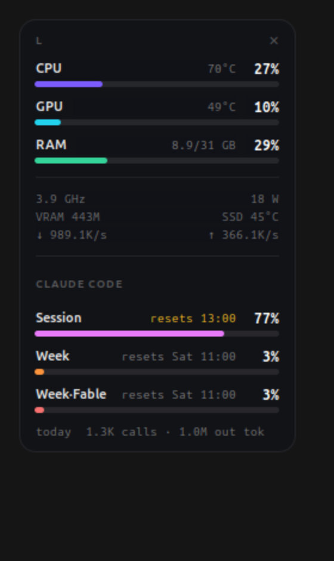
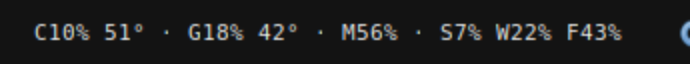
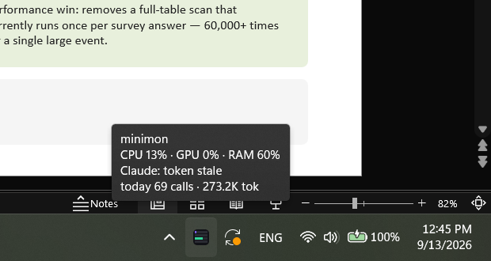
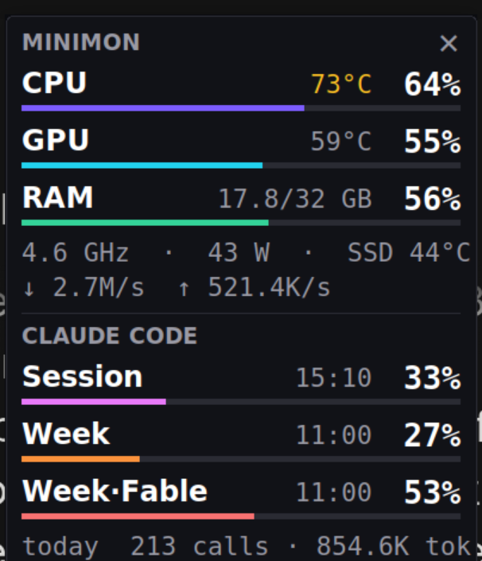

# minimon

An NZXT CAM "mini mode" style hardware monitor, for **Linux** (GTK) and
**Windows 11** (tkinter). It shows CPU / GPU / RAM load and temperatures, clock
speed, GPU power, SSD temperature and network rates — in a small always-on-top
card, and in the panel or taskbar.



Same readout on both systems:

- **Linux** — a GNOME top-bar label with a click-out popup card, a lighter
  AppIndicator dropdown, or a standalone floating card.
  
- **Windows 11** — a live label in the taskbar next to the Wi-Fi / volume /
  battery icons, plus a system-tray icon, with the floating card one click away.
  

Jump to: [Install on Windows 11](#install-on-windows-11) ·
[Install on Linux](#install-on-linux) · [Controls](#controls) ·
[Options](#command-line-options) ·
[Temperature history](#temperature-history-linux) ·
[Where the numbers come from](#where-the-numbers-come-from)

---

## Install on Windows 11

### 1. Optional but recommended: LibreHardwareMonitor (for temperatures)

Windows has no unprivileged way to read CPU/GPU temperature — that needs a
kernel driver. minimon gets those numbers from
[LibreHardwareMonitor](https://github.com/LibreHardwareMonitor/LibreHardwareMonitor)
(LHM) when it is running. Without it, minimon still shows CPU / RAM / network
load, and quietly notes `no LHM`; temperatures, GPU load/power
and clock speed just read `--`.

1. **Install it:**

   ```
   winget install LibreHardwareMonitor.LibreHardwareMonitor
   ```

   (or download it from its
   [releases page](https://github.com/LibreHardwareMonitor/LibreHardwareMonitor/releases)).

2. **Run it as Administrator.** The sensor driver only loads with admin rights;
   started normally, most temperatures stay blank.

3. Turn on **Options → Remote Web Server** (it serves sensor JSON on
   `http://localhost:8085`). minimon reads that, and falls back to LHM's WMI
   namespace if the web server is off.

4. So it is always there, also tick **Options → Run On Windows Startup**,
   **Start Minimized**, and **Minimize To Tray**.

minimon detects LHM **live**, within a couple of seconds — you can start it
before or after minimon, in either order.

### 2. Install minimon

Grab `minimon-win-x64.exe` from the [latest release](../../releases/latest).
It is a self-contained PyInstaller build — no Python and no third-party
packages required.

- **Just run it:** double-click the exe. It appears in the taskbar (see
  [Using minimon on Windows](#using-minimon-on-windows) below).

- **Install it so it starts at login** (recommended): put the exe in a folder
  next to [`install-win.ps1`](install-win.ps1) from this repo, then:

  ```
  powershell -ExecutionPolicy Bypass -File install-win.ps1
  ```

  This copies the exe to `%LOCALAPPDATA%\minimon`, adds a **Startup shortcut**
  so it launches at login, and starts it.

- **Upgrade:** download the newer exe and re-run `install-win.ps1` the same
  way — it replaces the installed copy in place and keeps the shortcut pointed
  at it. It also deletes the hourly **"minimon token refresh"** scheduled task
  that versions with Claude usage bars registered.

- **Uninstall:** `powershell -ExecutionPolicy Bypass -File install-win.ps1 -Uninstall`
  removes the Startup shortcut (and that legacy task, if it is still there).

**Run from source instead:** `pythonw minimon-win.pyw` with `minimon_core.py`
alongside it. Any Windows Python 3.10+ works and tkinter ships with it; there
are no other dependencies. `--demo` renders synthetic data on any OS.

### Using minimon on Windows

minimon lives in the taskbar in two parts:

- **The readout** — the same live label the GNOME extension shows
  (`C4% 55° · G2% 45° · M48%`), drawn just left of the notification icons.
  `--format` takes one template per line if you want it stacked like the
  two-line clock beside it.
- **The tray icon** — a miniature of the card (CPU, GPU and RAM meters; a
  meter turns red when that part is at 85 °C or hotter), with the full numbers
  in its tooltip.

Both respond the same way:

- **Left-click** (or Enter/Space on the icon) toggles the floating card. `✕`,
  `Esc` and Alt+F4 hide the card back into the taskbar; **Quit** is in the menu.
- **Right-click** opens the menu: Show/Hide card, Snap top-right,
  *Always show icon in taskbar*, Quit.
- On its first run minimon pins its tray icon into the always-visible corner
  (Windows 11 otherwise hides new icons behind the `^` overflow). That is the
  *Always show icon in taskbar* toggle — the same switch as Settings ›
  Personalization › Taskbar › Other system tray icons.
- Launching the exe while it is already running just brings the card back.

It is all plain Win32 through ctypes — no third-party packages. The tray icon
is `Shell_NotifyIcon`; the readout is a layered child window parked inside the
taskbar (the technique [TrafficMonitor](https://github.com/zhongyang219/TrafficMonitor)
uses), because the taskbar exposes no text API of its own.



---

## Install on Linux

### 1. Dependencies

The card and daemon need GTK 3 and PyGObject; the AppIndicator bar also needs
the Ayatana AppIndicator typelib. Sensors are read straight from `/proc` and
`/sys/class/hwmon`, so no sensor daemon or extra package is required — the
temperatures you see depend only on which kernel hwmon drivers are loaded
(`k10temp`, `amdgpu`, `coretemp`, `nvme`, …), which is automatic on a normal
install. NVIDIA GPUs have no such sysfs files; minimon reads them through NVML
(`libnvidia-ml`), which the NVIDIA driver installs.

- **Debian / Ubuntu:**

  ```
  sudo apt install python3-gi gir1.2-gtk-3.0
  sudo apt install gir1.2-ayatanaappindicator3-0.1   # only for minimon-bar.py
  ```

- **Fedora:**

  ```
  sudo dnf install python3-gobject gtk3
  sudo dnf install libayatana-appindicator-gtk3      # only for minimon-bar.py
  ```

### 2. Pick a form and install it

minimon comes in three interchangeable Linux front-ends. All share the same
sensor plumbing.

**a) GNOME Shell extension + daemon (the autostarting default).** A compact
live label in the top bar; clicking it opens a popup that reproduces the
floating card in full. `minimon-daemon.py` (autostarted) does the reading and
writes `~/.cache/minimon/status.json` once a second; the extension is a pure
renderer. The daemon also keeps the
[temperature history](#temperature-history-linux).

```
cp -r extension/minimon@klinsc.github ~/.local/share/gnome-shell/extensions/
gnome-extensions enable minimon@klinsc.github
# reload the shell: Alt+F2 → r → Enter  (X11), or log out/in (Wayland)
```

Then autostart the daemon (see [Autostart on Linux](#autostart-on-linux)).

**b) Floating card** — a standalone always-on-top GTK card (no extension):

```
python3 minimon.py
```

**c) AppIndicator bar** — a lighter text-only dropdown for non-GNOME panels:

```
python3 minimon-bar.py
```

`--format` customizes its label with `{cpu} {ct} {gpu} {gt} {mem}` tokens.

### Autostart on Linux

The bundled `.desktop` files use `/path/to/minimon` in their `Exec=` line —
edit that to your clone path, then copy one into `~/.config/autostart/`. The
extension's data engine installs at
`~/.config/autostart/minimon-daemon.desktop` (3 s session delay). To disable:

```
rm ~/.config/autostart/minimon-daemon.desktop
gnome-extensions disable minimon@klinsc.github
```

Only one instance can run: it holds an abstract-namespace socket lock, so a
duplicate launch prints `minimon is already running` and exits.

### Upgrading from a version with Claude usage bars

Older versions also showed Claude Code rate limits and kept its OAuth token
fresh with an hourly systemd user timer that ran the `claude` CLI. That is all
gone now; remove the timer, then restart the daemon (or log out and in) so it
picks up the new code:

```
systemctl --user disable --now claude-token-refresh.timer
rm ~/.config/systemd/user/claude-token-refresh.{service,timer}
systemctl --user daemon-reload
pkill -f minimon-daemon.py; python3 /path/to/minimon/minimon-daemon.py &
```

The GNOME extension is a copy, so re-copy it as in step 2a and reload the shell.

---

## Controls

| Action | Result |
|---|---|
| Left-drag anywhere on the card | move it (position is remembered) |
| Right-click the card / tray icon / taskbar readout | menu (snap, quit, …) |
| `✕`, `Esc` or `q` | quit — on Windows this hides the card into the taskbar; **Quit** is in the menu |

## Command-line options

**Windows** (`minimon-win.pyw` / the exe):

| Flag | Meaning |
|---|---|
| `--interval SECONDS` | refresh rate (default 1.0) |
| `--format LINE [LINE …]` | taskbar readout, one template per line, from `{cpu} {ct} {gpu} {gt} {mem} {mt}` (default: the GNOME label) |
| `--label-side {right,left}` | put the readout beside the tray icons (default) or at the taskbar's left end, if the centered app icons crowd it |
| `--no-label` | tray icon only, no taskbar readout |
| `--no-tray` | plain floating card only, no taskbar presence (`✕` quits) |
| `--hidden` | start with the card hidden (taskbar only) |
| `--demo` | synthetic sensor data (works on any OS) |

**Linux floating card** (`minimon.py`):

| Flag | Meaning |
|---|---|
| `--interval SECONDS` | refresh rate (default 1.0) |
| `--opacity 0-1` | card opacity (default 0.92) |
| `--width PX` | widget width (default 232) |
| `--pos X,Y` | initial position |

Card position is stored in `~/.config/minimon.json` (Linux) /
`%APPDATA%\minimon\config.json` (Windows).

The AppIndicator bar (`minimon-bar.py`) takes `--interval` and `--format`
(tokens `{cpu} {ct} {gpu} {gt} {mem}`).

The daemon (`minimon-daemon.py`) takes `--no-log` to turn off the
[temperature history](#temperature-history-linux).

---

## Temperature history (Linux)

`minimon-daemon.py` also keeps a log of how hot the machine runs, so you can
tell whether it is fine for long hours of use. Once a minute it writes the
average and the peak of each temperature (CPU, GPU, SSD, and RAM when the
DIMMs have a sensor) and the average CPU and GPU load to
`~/.local/share/minimon/temps-YYYY-MM.csv`. That is one file a month, about
3 MB. Files older than 13 months are deleted. The CSV opens in any spreadsheet
if you want graphs.

The floating card and the AppIndicator bar don't log. If you use one of those,
autostart the daemon too (see [Autostart on Linux](#autostart-on-linux)): it
has no window and costs next to nothing. After updating minimon, restart the
daemon so it starts logging:

```
pkill -f minimon-daemon.py; python3 /path/to/minimon/minimon-daemon.py &
```

To see how it has been going:

```
python3 minimon_history.py              # the last 7 days
python3 minimon_history.py --days 30
```

```
Temperatures over the last 7 days: 112.0 h logged, 2026-11-04 17:19 to 2026-11-11 17:19

part    avg   idle   busy   peak     warm      hot   verdict
CPU    56°C   48°C   84°C   88°C  15h 00m       0m   warm
GPU    48°C   43°C   72°C   74°C       0m       0m   ok
SSD    50°C      -      -   54°C       0m       0m   ok

avg, idle, busy: average temperature overall, at under 20% load, and at 75%+ load
peak: the hottest single reading
warm, hot: total time the per-minute average was at or above: CPU 80/90°C, GPU 80/90°C, SSD 70/80°C

CPU averaged 80°C or more for 15h 00m (13% of the time): within spec, but its cooling has little headroom left. Little of it was at rest: during those minutes the CPU averaged 97% load and the GPU 3%.

per day     hours    CPU avg/peak    GPU avg/peak    SSD avg/peak
2026-11-09   16.0         58/88           48/74           50/54
2026-11-10   16.0         58/88           48/74           50/54
2026-11-11    9.3         60/88           43/44           50/54
```

How to read it:

- **warm** and **hot** are the levels each part is judged by: CPU 80 / 90 °C,
  GPU 80 / 90 °C, SSD 70 / 80 °C, RAM 65 / 80 °C. Warm is within spec, but the
  cooling has little headroom left. Hot is close to where the part slows
  itself down to protect itself (CPUs at about 95–100 °C, GPUs 90–95 °C,
  NVMe SSDs 80–85 °C, DDR5 85 °C). The times are minutes whose average was at
  or above that level, so a one-second spike doesn't count.
- **verdict** is `ok`, `warm` (warm more than 10% of the time, or hot at all),
  or `HOT` (hot more than 1% of the time, and at least 5 minutes). It needs an
  hour of log first.
- **idle**, **busy** and the note under the table tell hard work apart from
  bad cooling. For every warm minute the report checks how busy the CPU and
  the GPU were:
  - **Warm with both at rest** (under 10% load) points at the cooling itself:
    dust, a slow or failed fan, dried thermal paste, poor airflow. For the SSD
    it may also be the drive's own copying, which the log doesn't record.
  - **Warm while the GPU is busy** usually means the GPU's heat is warming the
    air inside the case, which every other part breathes. More case airflow
    helps most.
  - **Light work is not rest.** Modern CPUs boost a few cores as hard as they
    can, so on a Ryzen even 20% load runs about as hot as 100%.
- **per day**: daily averages that creep up over weeks of similar use are the
  usual sign of dust building up.

---

## Where the numbers come from

**Windows**

| Metric | Source |
|---|---|
| CPU load, RAM, network | Win32 (`GetSystemTimes`, `GlobalMemoryStatusEx`, `GetIfTable2`) — no dependencies |
| CPU/GPU temp, GPU load/power, clock, SSD temp | LibreHardwareMonitor (HTTP on :8085, or its WMI namespace) |

**Linux** — discovered from `/sys/class/hwmon` at startup, so it adapts to your
hardware:

| Metric | Source |
|---|---|
| CPU load / freq | `/proc/stat`, `cpufreq/scaling_cur_freq` |
| CPU temp | `k10temp` (Tctl) — falls back to `zenpower`, `coretemp`, `acpitz` |
| GPU load | `/sys/class/drm/card*/device/gpu_busy_percent` (AMD) |
| GPU temp / power / VRAM | `amdgpu` hwmon + drm sysfs |
| NVIDIA GPU load / temp / power / VRAM | NVML (`libnvidia-ml.so.1`, installed with the driver) via ctypes |
| RAM | `/proc/meminfo` (MemTotal − MemAvailable) |
| SSD temp | `nvme` hwmon (Composite) |
| RAM temp | `spd5118` / `jc42` hwmon when the DIMMs have sensors (typical DDR4 does not) |
| Network | `/proc/net/dev`, virtual interfaces filtered out |

---

## Building the Windows exe

The x64 exe is built by [GitHub Actions](.github/workflows/build-windows.yml)
(PyInstaller on a Windows runner); push a `v*` tag to cut a release. To build
locally:

```
pyinstaller --onefile --windowed --name minimon-win-x64 \
  --hidden-import minimon_core minimon-win.pyw
```
